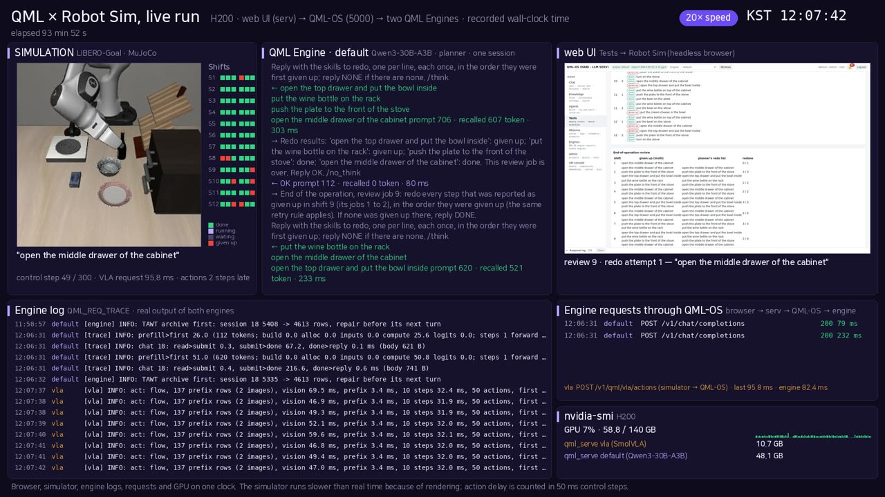
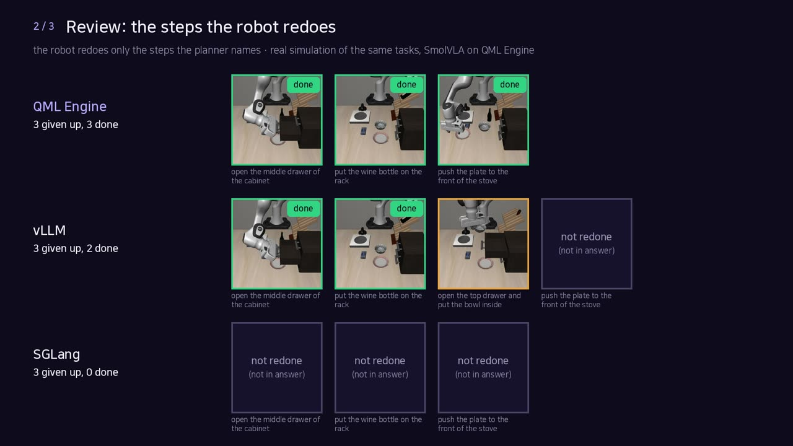

# QML Engine

A stateful inference engine for large language models, built for long-running, multi-user conversations on a single
server.

## Status

The source code and documentation will be published in this repository. Until then, this page only announces the
project and its current measurements.

- Engine: C++17 and CUDA, OpenAI-compatible HTTP API
- Targets: NVIDIA data-center GPUs, on-premises deployment
- License: to be announced with the source release

## Performance (H200, 2026-10-27)

One NVIDIA H200, one request at a time, BF16 weights, streamed through the OpenAI chat API. Time to the first token is the
median of three new prompts per size (nothing reused between requests); decode is the time per token over 256 generated
tokens. Same models and settings for every engine: llama.cpp `llama-server` (commit 7049ff0, flash attention on), vLLM
0.32.0, SGLang 0.5.22. qml-engine runs on its own kernels (no ggml graph) with its store on a local disk.

**Llama-3.1-8B-Instruct, BF16** (ms)

| Prompt (tokens) | qml-engine | llama.cpp | vLLM | SGLang |
|---|---|---|---|---|
| 133 | 15.1 | 25.0 | 24.3 | 14.1 |
| 598 | 26.6 | 77.9 | 40.4 | 25.5 |
| 2,340 | 80.5 | 251.9 | 78.1 | 73.3 |
| 8,892 | 308.3 | 992.7 | 291.4 | 313.7 |
| 26,926 | 1,164.5 | 3,504.0 | 976.2 | 937.0 |
| Decode (ms per token) | 5.62 | 5.10 | 4.97 | 4.99 |

**Qwen3-30B-A3B, BF16, mixture of experts** (ms)

| Prompt (tokens) | qml-engine | llama.cpp | vLLM | SGLang |
|---|---|---|---|---|
| about 130 | 21.2 | 66.2 | 25.7 | 23.1 |
| about 590 | 51.3 | 204.6 | 61.3 | 28.1 |
| about 2,340 | 120.9 | 612.1 | 83.3 | 61.5 |
| about 8,890 | 399.7 | 2,294.7 | 267.2 | 206.3 |
| about 26,900 | 1,379.8 | 7,252.8 | 943.3 | 889.8 |
| Decode (ms per token) | 4.80 | 5.06 | 3.97 | 3.59 |

Prompts of about 130 tokens, the common case in a conversation that keeps its KV, are as fast as vLLM and SGLang;
longer prompts and decode are 1.1 to 2.0 times slower than the faster of the two and are being worked on. These numbers are for a fresh request. A turn of a
session restores the conversation's KV from the engine's store, so only the new turn is prefilled.

## Memory over a long operation (H200, 2026-10-30 and 2026-10-31)

A planner model (Qwen3-30B-A3B) directs a simulated robot (LIBERO-Goal in MuJoCo, SmolVLA policy served by qml-engine)
through 16 shifts of jobs. A step the robot cannot finish is given up. After the last shift, one review per shift asks the
planner to redo every step given up in that shift, so a step comes back only if the planner remembers it.

Why the window is 8,192 tokens: it is the KV that each robot's session keeps on the GPU, and it is chosen for the number
of robots one GPU serves, not for this test. With Qwen3-30B-A3B one token of KV takes 96 KB (48 layers, 4 KV heads of 128,
bf16), so an 8K window is 0.8 GB per robot and 100 robots take 80 GB; a 40,960-token context per robot would take 4.0 GB,
and the same memory would hold about 20 robots. Within the 8K window qml-engine archives the turns that leave it in the
session's store and puts back the ones a question needs; sessions not being called stay in the store and are restored when
their robot calls. An engine without session memory keeps no KV per robot: its client resends the history on every call
(about 16K tokens after 16 shifts, growing with the operation), and the engine computes it again whenever its prefix cache
no longer holds it. A comparison of engines therefore has to be made with many robots on the same GPU (response time and
throughput at a given number of robots); this one-robot test does not measure that, and an 8K window given to the other
engines would only cut their history, so no engine comparison is shown here.

qml-engine at a window of 8,192 tokens, three seeds, scored from the run records: 94.9% of steps completed, 160 of 181
given-up steps redone, 46 of 48 review answers correct, no step redone that was never given up, 102 prompt tokens computed
per call. The client used qml-engine's own API: one session per operation (turns that leave the window are archived in the
session's store), the shift's time range sent with its review (`recall_range`), and the review prompt set as the session's
recall trigger (`on_match`). These are client choices that an OpenAI-API client does not have.

The same test run live through the web UI and the router (12 shifts × 2 jobs × 3 steps, engine window 8,192 tokens,
2026-10-31): 94.4% of steps completed (68 / 72) and 23 of 27 given-up steps redone. Reviews 2 to 12 each recalled 425 to
669 tokens of their shift from the session's store and named the given-up steps correctly. Review 1 missed its one
given-up step: when it ran, shift 1 had not yet left the window, so nothing was recalled (turns still in the context are
not put in twice) and the planner overlooked the record in a context of about 5,600 tokens.

Videos (click to play):

| The live run (4:29) | The comparison (1:48) |
|---|---|
|  |  |
| Web UI, simulator, engine logs, requests and GPU on one clock; 60× speed during the operation, 20× during the reviews. | SmolVLA on qml-engine vs lerobot in real-time control; the review answers of qml-engine, vLLM and SGLang. |

## Planned: 100 robots and long multi-job operations

The next measurements, to be added here when done (H200, Qwen3-30B-A3B planner, SmolVLA policy, both on qml-engine):

- **100 robots on one GPU, 8K session each.** 8 robots simulated live (LIBERO in MuJoCo) and 92 driven by recorded LIBERO
  results, all 100 planners called for real. Against vLLM and SGLang on the same GPU with the full history sent on every
  call: response time (median, p95), calls per second, steps completed, and recall of records that left the window.
- **Long multi-job tasks.** One instruction of 6 to 12 subtasks given at once instead of single-step commands. The planner
  splits it, the policy executes, a failed subtask is planned again, and the planner keeps the earlier subtasks, jobs and
  failures beyond its 8K window. Measured: tasks completed, subtasks reached, re-plans and their outcome.
- **Training data from the operation.** Every attempt recorded by the engine (camera frames, robot state, actions, outcome,
  the planner's exchanges) and exported as a LeRobot v3.0 dataset, successes and failure-recovery episodes alike, for
  fine-tuning the policy outside the engine; then the same tasks run again.

## Models

| Model | Weights | GPUs | Path |
|---|---|---|---|
| Qwen3-30B-A3B | Q3_K_M, BF16 | H200, B200 | engine's own kernels |
| Qwen3-32B | GGUF quantized | H200 | engine's own kernels |
| Llama-3.1-8B-Instruct | BF16 | H200 | engine's own kernels |
| Llama-3.2-3B-Instruct | GGUF | H200 | engine's own kernels (long attention not yet on cuDNN) |
| gpt-oss-20b | MXFP4 | H200 | engine's own kernels (attention sinks, sliding window) |
| Qwen3-Next, DeepSeek (MLA), Gemma, vision models | — | — | ggml backend for now |

Own kernel sets per GPU generation: sm_90 (Hopper: WGMMA, TMA) and sm_100 (Blackwell: tcgen05); sm_89 (Ada) runs the
decode kernels. Prefill attention uses cuDNN.

## Contact

KPST (Korea Platform Service Technology Co., Inc.)
